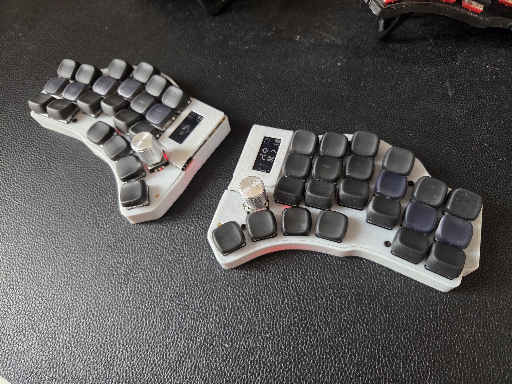

ZMK keymaps
===========

This repo contains configurations for my ZMK based keyboards

## Hillside View by Pletnev

[Hillside View](https://github.com/wannabecoffeenerd/HillSideView/) is a fork of [Hillside 46] with support for sharp display, bottom side MCU and future Cirque trackpad support.

### Layout

Made with https://nickcoutsos.github.io/keymap-editor/

### О прошивке
Персональная прошивка на ZMK для сплит-клавиатуры Hillside View с 46 клавишами, двумя энкодерами и дисплеями nice!view. Текущая конфигурация собирается для контроллеров nice!nano и поддерживает Bluetooth, USB, RGB-подсветку и настройку раскладки через ZMK Studio (конфигурация, варианты сборки).

Раскладка
Основные рабочие слои — базовый, символьный, цифровой, навигационный и настроечный. На больших пальцах используются двойные назначения: короткое нажатие вводит клавишу, удержание включает модификатор или дополнительный слой. Навигация открывается удержанием A/Ф, а одновременное удержание SYM и NUM включает настройки Bluetooth, подсветки и питания (описание слоёв).

Цифровой слой объединяет сетку цифр с операторами и символами для выражений. Энкодеры меняют назначение в зависимости от слоя: перемещение курсора, переключение вкладок, Page Up/Down и регулировка громкости; также предусмотрены Caps Word и tap-dance для ?/! (привязки клавиш и энкодеров).

Окружение
Раскладка рассчитана на совместную работу с Universal Layout
 в варианте без перестановки цифр и символов и скриптом AutoHotkey v2. Команды F13–F22 используются для буквального ввода @ $ ^ # | ~ [ ] { } независимо от активного языка. Отдельный игровой слой пока находится в разработке.

### Other docs
How to work with:
- [Displays](docs/Display_CheatSheet.md)
- [Keymaps](./docs/ZMK_KEYMAP_CheatSheet.md)
- [Mouse](./docs/Mouse_CheatSheet.md)